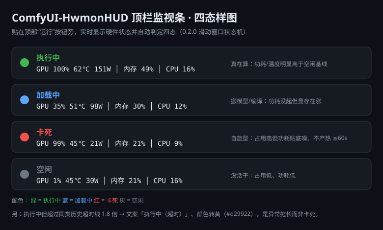

# ComfyUI-HwmonHUD

顶栏硬件监视条（纯 UI 扩展，不提供工作流节点）。独立实现，未复用任何第三方监控节点的代码。

## 这是什么（一句话）

一个贴在 ComfyUI 网页顶栏「运行」按钮旁边的小条：**实时显示 GPU / 内存 / CPU 状态，并自动判断 ComfyUI 是真在干活，还是卡死假忙。**

> 为什么需要它：GPU 占用 99% 不等于真在算。卡死/卡住时 GPU 也可能一直高占用但几乎不耗电——光看占用率会骗你。这个 HUD 用「功耗 + 温度」来戳破假象。

## 长什么样



三种状态一目了然：

- 绿（真·生产驴）：占用高，且功耗/温度明显高于空闲时 → 真在算。
- 红（假忙卡死）：占用高，但功耗/温度没比空闲时高多少 → 大概率是卡住了。
- 灰（空闲）：没活干，占用低、功耗低。

## 显示什么

在 Web UI 顶栏「运行 / 队列」按钮同一排，显示五项指标 + **判定状态**：

```
● 真·生产驴 │ GPU 98% 62° 172W │ 内存 43% │ CPU 39%
```

- **判定状态**（● 真·生产驴 / 假忙卡死 / 空闲 / 低负载）：这是"到底在真干活还是假死"的直接结论，
  判据与 `tools/hwmon` 完全一致——util 100% 会骗人，功耗 + 温度才说真话。
- **GPU 利用率 / GPU 温度 / GPU 功耗**：`nvidia-smi`（驱动自带，零依赖）
- **内存利用率**：`psutil`（ComfyUI 环境已有 7.2.2）；缺失时降级为 ctypes `GlobalMemoryStatusEx`
- **CPU 负载**：`psutil.cpu_percent(interval=None)`

CPU 温度**不显示**（2026-10-18 实测：Windows 不向普通程序开放，ACPI 直读为静态死值，四条路全断）。

## 判定逻辑（多因素综合 + 自适应基线）

**三个证据**：util 高（≥85%）｜功耗离基线（区间比 ≥55%，或绝对 ≥110W）｜温度离基线（ΔT ≥12℃）

| 状态 | 判据 |
|---|---|
| ⚪ 空闲 | util < 15% 且 功耗 < 60W |
| 🔴 假忙卡死 | util ≥ 85% 但 功耗与温度**都没离基线**（进程排队、不产帧）|
| 🟢 真·生产驴 | util ≥ 85% 且 有能耗证据；或 功耗 ≥ 110W（兜底）|
| 🟡 低负载/加载中 | 其余（加载/编译过渡）|

**为什么要自适应**：绝对线（56℃/110W）只对本机这类凉卡成立。高底温设备空闲就 55℃+，
绝对温度线会把空闲判成干活、把卡死漏判成正常 ⇒ 主证据改为"离本机空闲基线的距离"，
绝对温度线只在本机还没基线时兜底（且要求 util ≥50%）。基线存 `_data/baseline.json`，
只从空闲样本学习，30s 落盘。

**哪些指标自适应（原则：物理风险用绝对红线，本机常态用相对线）**

| 指标 | 自适应 | 绝对线 |
|---|---|---|
| GPU 功耗 | 空闲线 = max(60W, 底功耗×1.5)；真产用区间比 | ≥110W 即真干 |
| GPU 温度 | 黄线：≥75℃ 或 比底温高 18℃ | 红 83℃（降频点）|
| 内存 | 黄线：≥75% 或 比"干活常态"多 12pp | 红 90%（OOM）|
| GPU 利用率 | —（0–100% 是物理量）| 15/50/85% |
| 显存 | — | 90/95% |
| CPU 负载 | —（工作量取决于任务类型）| 15/50/85% |

**配色在服务端算**（`stats.py`），前端只做颜色名映射——终端 hwmon 与顶栏 HUD 永远同一套阈值。

刷新：前端 1.5s 轮询 `GET /comfyui_hwmon_hud/stats`，后端 1s TTL 缓存。

## 安装（三步，无需任何配置）

1. **关掉 ComfyUI**（节点必须重启才会加载）。
2. 把本仓库克隆到 ComfyUI 的 `custom_nodes` 目录：
   ```bash
   cd ComfyUI/custom_nodes
   git clone https://github.com/errboy/ComfyUI-HwmonHUD.git
   ```
3. 装依赖（绝大多数 ComfyUI 环境已自带 `psutil`，可跳过）：
   ```bash
   pip install -r requirements.txt
   ```
4. **启动 ComfyUI，浏览器里按 `Ctrl+F5` 硬刷新** → 顶栏「运行」按钮旁就出现监视条。

> 窗口宽度 <1100px 时会自动隐藏「GPU/内存/CPU」文字标签，只留判定状态，避免拥挤。

如果你用 comfy-cli 管理 ComfyUI，重启即可让节点生效：

```bat
comfy stop
comfy launch --background
```

（节点不需要任何额外参数；端口、工作区按你自己的 ComfyUI 配置即可。）

## 结构

```
ComfyUI-HwmonHUD/
├── __init__.py      # WEB_DIRECTORY + __version__ + 路由注册（失败不拖垮 ComfyUI）
├── api_routes.py    # GET /comfyui_hwmon_hud/stats（PromptServer 官方路由，asyncio.to_thread 采集）
├── stats.py         # 采集层：nvidia-smi + psutil + ctypes 降级 + 1s 缓存 + 多因素判定
├── web/hud.js       # 前端扩展：挂载 + 轮询 + 配色 + 悬停详情
├── pyproject.toml   # Registry 元数据（name/version/Repository/PublisherId）
├── requirements.txt # psutil>=5.9
├── LICENSE          # MIT
└── _data/           # 基线持久化（运行时生成，可删）
```

## 合规审查（2026-10-18，对照 ComfyUI 官方自定义节点规范）

| 项 | 状态 |
|---|---|
| 包结构：`__init__.py` + `WEB_DIRECTORY = "./web"` + 写进 `__all__` | ✅ |
| 纯 UI 扩展：`NODE_CLASS_MAPPINGS = {}` | ✅ 官方「仅客户端」类别的合法形态 |
| API 路由：`PromptServer.instance.routes` + 唯一前缀 | ✅ |
| 前端：`registerExtension({name: "ComfyUI.HwmonHUD", setup})` | ✅ |
| `pyproject.toml`（name/version/description/Repository/PublisherId） | ✅ 已补（PublisherId 待注册后填） |
| `requirements.txt` / `LICENSE` / `__version__` | ✅ 已补 |
| 日志：`logging`（`[ComfyUI-HwmonHUD]` 前缀），无 `print` | ✅ 已改 |
| 静态体检 | ✅ FAIL=0（唯一 WARN：PublisherId 仍是 TODO） |

开发规范、模板与体检工具见技能 `comfyui-node-authoring`（`~/.workbuddy/skills/`）。

## 挂载兼容（1.55.17 实测修正）

**新版 UI 里 `app.menu` 是遗留隐藏菜单**（祖先 `.comfy-menu` 为 `display:none`），插进去得到
0×0 的不可见元素——在 DOM、有文本、控制台无报错，就是看不见。实测唯一稳定可见的锚点是
`.queue-button-group`（"运行/取消"按钮组）。

挂载优先级：

1. 可见的 `.queue-button-group` 之前（与"运行"按钮同一排）
2. 可见的 `app.menu.settingsGroup.element` 之前（老版 UI）
3. 可见的 `#queue-button` 之后（更老）
4. 右下角固定浮窗

"挂上了"的判定 = `isConnected && rect.width > 0`：不可见就拆掉重挂；Vue 重渲染后 1.5s 内自动补回。

## 命名规范（防重名）

| 层级 | 名字 | 冲突风险与规则 |
|---|---|---|
| 目录 | `ComfyUI-HwmonHUD` | 社区惯例前缀 `ComfyUI-`（不强制，但人人这么起）；目录重名必须靠名字本身区分 |
| Registry 节点 ID | `hwmon-hud` | `pyproject.toml` 的 `[project].name`；官方规则：**不含 "ComfyUI"**、不能数字开头、<100 字符 |
| 节点类 | 无 | 本包 `NODE_CLASS_MAPPINGS = {}`，**不注册工作流节点**，所以节点菜单里没有条目、也没有类名重名问题 |
| 前端扩展名 | `ComfyUI.HwmonHUD` | ComfyUI 用 `app.registerExtension({name})` 的 name 去重，带前缀避免与其他扩展撞名 |
| DOM id | `comfyui-hwmon-hud` | 页面全局唯一 id，带前缀避免与其他扩展的 id 冲突 |
| HTTP 路由 | `/comfyui_hwmon_hud/stats` | aiohttp 路由是**全局表**，撞了会有一个失效，带前缀最稳 |

> 一句话：`ComfyUI-` 是给人看的惯例前缀，`comfyui_` 是给程序去重用的命名空间。

## 卸载

删除本目录并重启 ComfyUI 即可，无其他残留（不写配置、不注册节点）。

## 常见问题（通俗易懂）

**Q：装完顶栏看不到监视条？**
先按 `Ctrl+F5` 硬刷新（浏览器缓存了旧页面）；再确认你的 ComfyUI 是较新版（顶栏有「运行/队列」按钮那版）。

**Q：CPU 温度那一栏显示「—」？**
正常。Windows 默认不把 CPU 温度开放给普通程序读（ACPI 直读也是死值），所以这里故意留空，不造假数字。

**Q：温度符号是「℃」还是「°C」？**
已统一为正确的摄氏度符号 **℃**（U+2103 单一字符），不是「度 + 字母 C」。

**Q：判定会误报吗？**
它自动学习你这台机器的「空闲基线」（底温/底功耗），用「离基线的差距」来判，而不是死板的一个温度数字。
所以凉卡和高底温卡都能判对。前 30 秒还在学习时，会临时用绝对阈值兜底，属正常。

**Q：想自己改阈值怎么办？**
判定阈值集中在 `stats.py` 的 `TH` 字典里，注释和 `tools/hwmon` 的 `CFG` 互相提醒同步；一般不用动。
